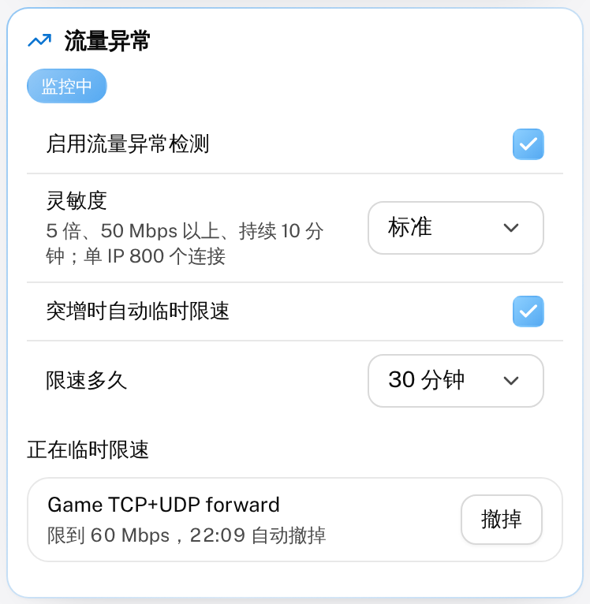
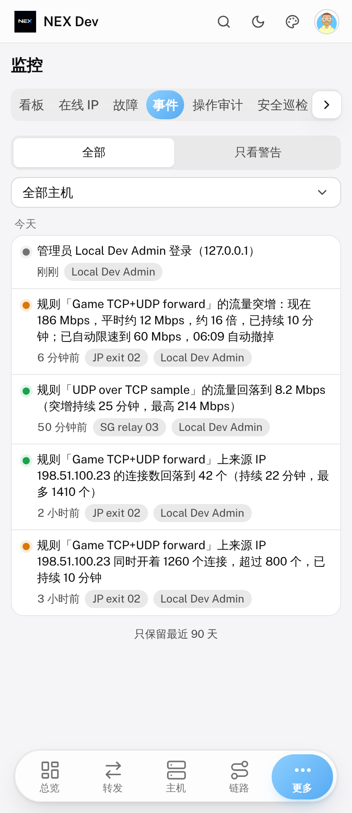
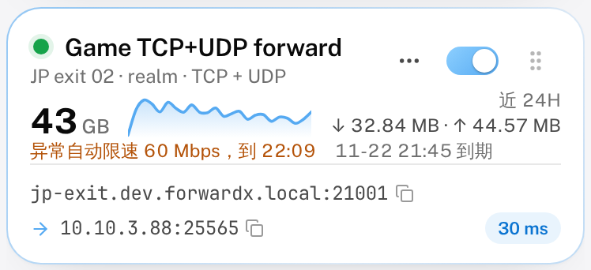

# 监控与告警

面板 2.3.451 起新增一组「出了事能马上知道、能马上查」的功能：资源告警、内存耗尽 / 进程崩溃 / 隧道丢包告警、流量异常检测、面板内实时日志、故障看板和逐跳连接监控。

| 功能 | 在哪里 | 需要 |
| --- | --- | --- |
| 资源告警（CPU / 内存 / 磁盘） | 系统设置 → Webhook → 资源告警 | 任意 Agent |
| 内存耗尽（OOM）、进程崩溃告警 | 同上 | Agent 2.2.230 |
| 隧道丢包告警 | 同上 | 任意 Agent |
| 流量异常（流量突增、单 IP 连接暴涨、可选自动限速） | 系统设置 → Webhook → 流量异常 | 任意 Agent |
| 实时日志 | 主机详情底部 →「实时日志」 | Agent 2.2.230 |
| 故障看板 | 监控 → 故障 | — |
| 操作审计 | 监控 → 操作审计 | — |
| 逐跳连接监控 | 链路管理 → NEX 隧道的「诊断」→「连接监控」页签（管理员） | FXP 2.2.133 |
| 指标导出（Prometheus / Grafana），见[指标导出](./metrics) | 系统设置 → 进阶 → 指标导出 | — |

以上都只有管理员能看、能改。

## 资源告警

打开「启用资源告警」后，面板在每次心跳时检查主机的 CPU、内存、磁盘使用率：

- **持续超过阈值才报**：一次冲高不报，连续超过「持续多久才报」（默认 5 分钟）才发一条「超过」告警。中间有一次回落，计时从头算。
- **回落才算恢复**：回到「阈值 − 恢复回差」以下（默认阈值 90%、回差 5，即 85% 以下）才发一条「恢复」，消息里带上告警期间的最高值和持续时长。避免在阈值附近来回报。
- **阈值填 0** 表示这一项不报。

同一个开关下还有三类事件告警：

| 告警 | 什么时候报 | 说明 |
| --- | --- | --- |
| 内存耗尽（OOM） | 内核 OOM killer 杀了进程 | 读 `/proc/vmstat` 的 `oom_kill` 计数，涨了就报；机器重启后从头计 |
| 进程崩溃 | `forwardx-*` 服务崩溃后被 systemd 自动拉起 | 读 systemd 的 `NRestarts`；手动 `systemctl restart` 会把计数清零，不会误报 |
| 隧道丢包 | 入口探测隧道近 10 分钟丢包率达到阈值（默认 20%） | 至少 10 次探测才判定；回落到阈值一半以下算恢复 |

告警通过以下渠道发出：

- **Telegram / Discord**：按各自的通知开关发。每个管理员可以在机器人「通知设置」里单独关掉「资源告警」这一类，不影响其他管理员。
- **邮件**：勾选「同时发邮件」后，发给有邮箱的管理员（需要「系统设置 → 邮件」已开启）。
- **事件时间线 / Webhook**：所有告警都会记进「监控 → 事件」，Webhook 的「主机上下线与重启」类会一起推出去。

点「发送测试告警」可以确认渠道是通的。

## 流量异常

某条规则或某个用户的流量突然比平时高出好几倍、某个来源 IP 在一条规则上开了成百上千个连接时，面板自动发现、告诉你，不用等到月底看账单、或者机器被打满才知道。**默认关闭**，在「系统设置 → Webhook → 流量异常」打开。

### 怎么判定

面板每分钟看一次（不需要 Agent 多报任何东西，用的是已有的实时速率、流量分桶和在线 IP）：

- **速率取较大的一向**：上行、下行里大的那个，单位 Mbps。转发组按整组（所有成员加起来），线路组的中转跳不重复算。
- **「平时」怎么算**：取下面两个里**大的那个** ——
  - 近 3 天每 30 分钟一档的**中位数**（最近一小时不算进去，免得正在冲高的那段把「平时」一起拉高）；
  - 前几天**同一时段**（前后各半小时）的典型值。每天固定的晚高峰因此不会被当成突增。
- **算突增**：现在 ≥ 平时 × 倍数，**并且** ≥ 绝对下限，连续超过「持续时间」才报。中间回落一次，计时从头算。
- **单 IP 连接暴涨**：一条规则上同一个来源 IP 的连接数（几台入口机加起来）达到阈值，同样要持续够久。
- **恢复**：回落到异常线的 70% 以下、同样连续那么久，才报一条恢复（带持续多久、期间最高多少）。

灵敏度三档（默认「标准」），也可以选「自定义」自己填：

| 灵敏度 | 平时的几倍 | 至少 | 持续 | 单 IP 连接数 |
| --- | --- | --- | --- | --- |
| 灵敏 | 3 倍 | 20 Mbps | 5 分钟 | 300 |
| 标准（默认） | 5 倍 | 50 Mbps | 10 分钟 | 800 |
| 宽松 | 10 倍 | 100 Mbps | 15 分钟 | 2000 |

单 IP 连接数填 0 表示不看连接数。

### 会不会误报

尽量少报，代价是可能漏掉一些：

- **新规则不判**：规则（用户）建起来不满 24 小时，或者面板自己攒的流量分桶不满 24 小时（刚升级、刚换数据库），都没有「平时」，不判。
- **冷却**：同一条规则（用户、IP）报过一次之后 6 小时内再犯，不再发事件和通知，只写面板日志；对应的那次恢复也不报。
- **一轮最多 10 条**：被打的时候一下子几百个 IP 超线，只报前 10 条，其余写日志。
- **会报的情况**：一条放了三天没人用的老规则突然跑到 50 Mbps 以上，「平时」是 0，会报 —— 这正是想知道的。用户层面同理：老用户在一条刚建的规则上突然跑满，规则本身太新不判，但用户这一级会报。
- **面板重启后**判定从头计时、冷却从头算，还在超线的会在持续时间到了后再报一次。

单 IP 连接数的局限：数据来自「在线 IP」（Agent 默认 60 秒报一轮），只看规则对外的那个端口，每个端口最多 256 个 IP，面板自己管的主机地址（隧道上一跳、中转回连）不算。适合发现「一个 IP 开了几千个连接」，不适合做精细的连接审计。

### 通知

每次异常、每次恢复都记一条事件，在「监控 → 事件」和「监控 → 故障」（「流量异常」一类）里能看到；Webhook 的「规则与线路异常」「用户流量与到期」两类会一起推出去。

管理员通知和资源告警走同一路：Telegram、Discord 按各自的开关发，每个管理员可以在机器人「通知设置」里关掉「资源告警」这一类（流量异常也就一起不收）。不发邮件，也没有新的通知渠道。

### 自动临时限速（可选）

勾上「突增时自动临时限速」（**默认关**）后，规则流量突增时面板顺手给这条规则加一个临时限速：

- **限到多少**：就限到异常线（平时 × 倍数，和绝对下限取大的），转发组 / 线路组按整组一起限。用的是规则自己的那一级限速（和规则表单里管理员设的限速同一个桶），上下行各限这个数。
- **什么时候撤**：到了「限速多久」（默认 30 分钟）自动撤；期间流量回落、报了恢复也会撤。到点撤掉后如果还是一直超线，要再连续超过持续时间才会再限一轮（冷却里不另发事件，规则卡上看得到）。
- **不碰手动限速**：临时限速另存一份，下发时和人手动设的限速取严的那个。手动设的更严就不加；撤掉临时限速就回到手动那个数。手动限速从来不会被它改掉或撤掉。
- **面板重启**：重启前加上的临时限速会记在库里，启动时收回 —— 功能还开着就接着管、到点照样撤；已经过期、规则删了、或者功能已经关掉的，启动时当场撤掉。
- **只限规则**：用户层面的突增、单 IP 连接暴涨只通知，不自动限速。

正在限速的规则，卡片上会写「异常自动限速 60 Mbps，到 14:30」：

设置里「正在临时限速」列出所有正在生效的，误报了点「撤掉」—— 这一轮异常直到恢复都不会再自动加回来。

### 怎么关

- 关掉「启用流量异常检测」：不再判定，正在生效的临时限速当场全部撤掉。
- 只关「突增时自动临时限速」：照样报，正在生效的临时限速当场撤掉。
- 只是不想收通知：在 Telegram 机器人的「通知设置」里关掉「资源告警」，事件时间线照样记。

## 实时日志

主机详情弹窗最下面的「实时日志」默认收起，点开后：

- 选择来源：Agent、gost 运行时、隧道运行时、Nginx Stream、内核，以及这台机器上每个 FXP 进程的日志文件。
- 新日志大约 5 秒内出现；可以按关键字筛选、暂停、清屏、下载成 `.log` 文件。
- 关掉窗口后不再拉取，Agent 半分钟后回到平时的节奏。

只读、白名单：Agent 只读这几个固定来源（不接受任意路径或命令），每行截到 2000 字符，日志里的 `password=`、`token=`、`Authorization` 等值会被打码。

## 故障看板

「监控 → 故障」一页看清当前状况：

- **在线主机**、**告警条数**（其中严重几条）、**自动恢复次数**、**平均恢复用时**，可切换 24 小时 / 3 天 / 7 天。
- **正在告警**：离线的主机、还没回落的资源告警和隧道丢包。
- **告警分布**：按类别（断线、资源超限、内存耗尽、进程崩溃、隧道丢包、规则出错、线路切换、流量异常……）和按小时的柱状图；**告警最多的主机**。
- **最近的告警**。

两个导出按钮：

- **导出 CSV**：这段时间的事件，一行一条，Excel 直接打开。
- **导出故障报告**：JSON，带上汇总、离线主机和正在告警的项，密钥按支持包同一套规则打码，适合交给技术支持或 AI 分析。

需要整台机器的诊断输出（网络、服务状态、日志尾部）时，用「系统设置」里的支持包。

## 操作审计

「监控 → 操作审计」把每一次写操作记一行：谁（账号、角色，用 API 令牌时带上令牌名）、什么时候、从哪儿来（网页、API 令牌、MCP、Telegram 机器人）、IP 和客户端、调了哪个接口、带了什么参数、成没成、花了多久。设置、用户、套餐、计费、规则、主机、令牌……网页上能改的，经 API 令牌、MCP、机器人改也一样会记。

- **参数打码**：密码、密钥、令牌、验证码这类字段整项显示成「[已隐藏]」，长得像 PEM 证书私钥、面板令牌、JWT 的值也一样；参数超过 4 KB 只留前一截。
- **被拒绝的也记**：没有管理员权限、令牌权限不够的写操作记成「被拒绝」；参数不对、出了错的记成「失败」，带上原因。没登录的请求（登录、注册、验证码）不记。
- **改了哪些字段**：改规则 / 主机 / 隧道 / 转发组时，点开那一行能看到这次请求改动前后每个字段的值。
- **不记的**：只是「跑一下看看」的测速、诊断、连通性检查、测试发送，登录流程的每一步，以及预览、轮询这类不改东西的调用。
- **筛选**：按结果、模块、操作人、时间范围；搜索框能搜接口名、操作人、IP、参数和出错原因。
- **保留天数**：默认 90 天，筛选栏最后的「保留 N 天」可改成 30 / 180 / 365 天，每天清掉过期的记录。

## 逐跳连接监控

普通的「诊断」「延迟记录」是面板主动发探测；连接监控记录的是**真实用户连接本身**在每一跳、每个阶段花了多久、成没成：

| 阶段 | 发生在 | 含义 |
| --- | --- | --- |
| 连接池 | 入口 / 中转 | 从预热好的连接池直接拿到下一跳连接，不用拨号 |
| TCP 连接 | 入口 / 中转 | 拨下一跳的 TCP |
| 加密握手 | 入口 / 中转 | 和下一跳完成加密握手确认（从开始拨号算起） |
| 连目标 | 出口 | 出口拨目标地址 |
| 每一路 | 入口 | 单连接叠加：拨每一路（中转）并报到（FXP 2.2.135 起） |

每一行给出次数、成功率、平均 / P50 / P95 / 最慢耗时和最近一次失败原因（如 `timeout`、`connection refused`），下面是每个阶段每小时的成功率走势，能一眼看出是哪一跳、在哪个时段出问题。数据由 FXP 每分钟上报一次，保留 7 天，可导出 CSV / JSON。

中转是「单连接叠加」的隧道，顶上还有一栏 **每一路**：每台中转最近 5 分钟上下行的平均速率、这段时间各占多少、拨了几次成没成。哪一路一直分得少，多半是那台中转线路不行或者「线路带宽」填得不对。

只有 NEX 隧道（FXP）有这项数据；Agent 升级到 2.2.230 后会同时带上 FXP 2.2.133。
